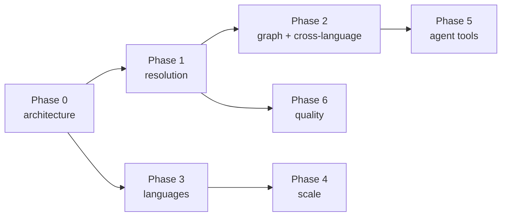

# Roadmap

> **Status:** planning document. Nothing here is committed work; ordering and scope will
> change as the crawler is used on real repositories.
>
> **Guiding principle:** the crawler is not a compiler. It should stay fast, explainable,
> and explicit about what it does not know. When a question needs full semantic analysis,
> the honest answer is a confidence score and a reason — not a guess.

---

## Current baseline

| Area | Today |
|---|---|
| Languages | Java, Python, TypeScript, JavaScript |
| Parsing | `LanguageConfig` per language over tree-sitter WASM grammars |
| Resolution | `javaResolver.ts` + `genericResolver.ts` (module-based languages) |
| Graph | SQLite property graph: 15 node kinds, 13 edge kinds, WAL |
| Tools | 22 MCP tools |
| Tests | 13 files / 125 tests, per-language fixtures |

The biggest structural gap is that **adding a language currently means writing two
parallel implementations** — a `LanguageConfig` and a resolver — and teaching each parser
about framework conventions. Phase 0 removes that before any new language lands.

---

## Phase 0 — Make language #5 cheap

*Goal: a new language is one config module, one resolver module, one fixture directory.*

| Item | Change | Effort |
|---|---|---|
| 0.1 | Collapse `javaResolver.ts` and `genericResolver.ts` behind one `Resolver` interface with declared capabilities | M |
| 0.2 | Move framework detection out of parsers into `src/parser/frameworks/<framework>.ts`, keyed by import evidence | M |
| 0.3 | One language descriptor: extensions → grammar → resolver → frameworks → fixture path | S |
| 0.4 | Conformance suite every language must pass (types, calls, imports, one route, one reflection) | S |
| 0.5 | `.crawlerrc.json` — include/exclude globs, language overrides, module roots, tsconfig paths, Python package roots | S |

**Exit criteria:** a new language needs no edits to existing language modules, and CI
fails if the conformance suite regresses.

## Phase 1 — Resolution quality

Highest value per hour of work; every unresolved edge today is a question an agent
cannot answer.

- **Monorepo roots.** `tsconfig` `paths`/`baseUrl`, `package.json` workspaces,
  `pyproject.toml` / `setup.cfg`, Maven and Gradle module boundaries.
- **Python.** Relative-import depth, `__init__.py` re-exports (`__all__`), star imports,
  `conftest.py`, `functools.wraps` signature preservation.
- **TypeScript/JavaScript.** Barrel files, `export default`, type-only imports, generics
  on receivers, `satisfies`, React components (JSX return → component) and hooks.
- **Python route attribution.** `framework` on a `ROUTES` edge currently reports the
  decorator receiver (`router`), not the library. Attribute `fastapi` / `flask` /
  `quart` from imported symbols so route reports group by framework.
- **Visible failures.** Aggregate resolver `reason` values into a `find_unresolved` tool
  and surface them in `get_node`. Unresolved edges are acceptable; unexplained ones are not.
- **Optional compiler-assisted mode.** A `tsc` program or `jdtls` bridge behind a flag for
  teams that prefer precision over setup cost.

## Phase 2 — Graph completeness and the polyglot payoff

- **First-class `route` nodes.** Routes are currently properties on `ROUTES` edges, so
  "who calls `GET /orders/{id}`" cannot be asked. Route nodes make them traversable.
- **Cross-language edges.** `fetch("/api/orders")` in TypeScript → route node → Spring or
  FastAPI handler. This is the capability no single-language indexer offers.
- **New edges.** `INSTANTIATES`, `OVERRIDES`, `EXPORTS`, `RETURNS`, `THROWS`,
  `READS` / `WRITES` (field access, enabling data-dependency queries), `CALLS_HTTP`.
- **New node kinds.** `function`, `variable`, `namespace`, `struct`, `trait` — the last two
  are prerequisites for Go, Rust, and C#.

## Phase 3 — Language rollout

Ordered by value ÷ modelling cost.

| Language | Grammar | New modelling required | Frameworks | Effort |
|---|---|---|---|---|
| **Go** | `tree-sitter-go` | structs, implicit interface satisfaction (dispatch fan-out), `panic`/`recover` | `gin`, `echo`, `chi`, `net/http`, `wire`, `fx` | S–M |
| **C#** | `tree-sitter-c-sharp` | attributes, properties, generics — close to Java, reuses Phase 0.1 | ASP.NET Core attribute routing, `[FromServices]`, MediatR | M |
| **Kotlin** | `tree-sitter-kotlin` | top-level and extension functions, data classes, coroutines | Spring, Ktor | M |
| **Ruby** | `tree-sitter-ruby` | `method_missing`, `send`, `require`, open classes — reflection is the default | Rails routes, ActiveRecord, `Concern` | M–L |
| **Rust** | `tree-sitter-rust` | traits and `impl` blocks, modules, best-effort macro handling | axum, actix | L |
| **PHP** | `tree-sitter-php` | traits, namespaces, magic methods | Laravel container and facades, Symfony | M–L |
| Swift / C / C++ | not yet scoped | not yet scoped | Vapor (Swift only) | L–XL |

Two rules for every language added:

1. It ships with a fixture project and conformance tests in the same pull request.
2. It documents what it does **not** model, in `README.md` and `USAGE.md`.

### Non-code surfaces (higher value than a ninth language)

Each of these fits the `LanguageConfig` shape and produces far more insight per line than
another general-purpose language:

- **SQL** — tables, columns, and queries as nodes and edges, so `get_callers` works on a
  table and schema changes become impact analysis.
- **OpenAPI / protobuf** — contracts as nodes, enabling cross-service `CALLS_HTTP` edges.
- **Docker / compose** — deployment topology as a second graph layer.

## Phase 4 — Scale

- **Incremental indexing.** Content hashes plus dependency-aware invalidation;
  `crawl_project` reports `added` / `updated` / `removed`. Today it is a full re-crawl.
- **Parallel parsing** with worker threads; batched transactions (WAL and core indexes
  already exist in `store.ts`).
- **Budget caps and progress** for very large repositories; a `code-crawler watch` mode.
- **Benchmark fixture** with an explicit target, e.g. 100k LOC in under 60 seconds.

## Phase 5 — Agent ergonomics

- **`search_symbols` on SQLite FTS5** with fuzzy fallback and an optional semantic tier.
  It is currently a `LIKE '%query%'` scan in `queries.ts`.
- **New tools.** `find_unresolved`, `explain_symbol` (one-shot context bundle),
  `diff_graph`, `impact_analysis`, `find_cycles`, `export_graph` (Mermaid, DOT, GraphML).
- **Token budgets.** A `max_tokens` option on list-returning tools — MCP clients are
  context-limited, and 50 verbose nodes can consume a turn.
- **MCP resources and prompts** so the graph is addressable as context, not only through
  tool calls.

## Phase 6 — Quality and release

- Golden snapshot tests of graph output per language.
- A conformance gate in GitHub Actions.
- `npm publish` with provenance.
- Docs updated in the same pull request as each phase — the `USAGE.md` + docs-site
  pattern already used for releases.

---

## Sequencing

Effort key: **S** ≤ 1 day · **M** 1–3 days · **L** 1–2 weeks · **XL** > 2 weeks.

## Non-goals

These are deliberate exclusions, not backlog items:

- Value flow, points-to analysis, and branch feasibility.
- Symbolic execution or anything requiring a full type checker in the default path.
- Runtime instrumentation or execution tracing of a live process.
- Crawling third-party dependencies. External code stays an `ext:` summary.
- Cross-repository resolution beyond explicit service contracts (Phase 2).
