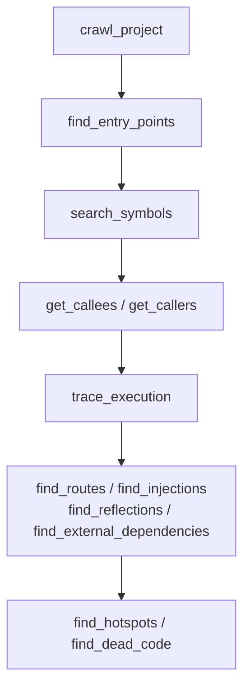

# Usage guide

A task-oriented guide to `@nithin554/code-crawler`. If you want the feature tour, read
the [README](README.md); if you want to *do* something, start here.

- [1. Install and index](#1-install-and-index)
- [2. Crawling a real project](#2-crawling-a-real-project)
- [3. The agent workflow](#3-the-agent-workflow)
- [4. Recipes](#4-recipes)
- [5. Reading the results](#5-reading-the-results)
- [6. Per-language examples](#6-per-language-examples)
- [7. What is and is not modelled](#7-what-is-and-is-not-modelled)
- [8. Troubleshooting](#8-troubleshooting)

---

## 1. Install and index

Requires Node.js ≥ 20.

```bash
npm install
npm run build
```

Index a project (any mix of Java, Python, TypeScript, and JavaScript):

```bash
node dist/index.js crawl /path/to/your/repo
```

Check what landed in the index:

```bash
node dist/index.js status
```

```json
{
  "files": 26,
  "nodes": 192,
  "edges": 266,
  "languages": ["java", "python", "typescript"],
  "resolvedCalls": 31,
  "unresolvedCalls": 9,
  "routes": 6,
  "injections": 7,
  "reflections": 3,
  "entryPoints": 9,
  "externalDependencies": 9
}
```

Then start the MCP server:

```bash
node dist/index.js serve     # stdio; this is the default subcommand
```

### Configuration

All settings are environment variables, so they work the same from the CLI and from an
MCP client:

| Variable | Default | Purpose |
| --- | --- | --- |
| `CODECRAWLER_DB` | `~/.code-crawler/index.db` | SQLite file that holds the graph |
| `CODECRAWLER_EXCLUDE_DIRS` | `.git,node_modules,dist,build,target,...` | Directories skipped during crawl |
| `CODECRAWLER_DEFAULT_LIMIT` | `50` | Default cap on result lists |
| `CODECRAWLER_MAX_DEPTH` | `10` | Traversal depth cap (1–100) |
| `CODECRAWLER_MAX_FILE_BYTES` | `1000000` | Files larger than this are skipped instead of parsed (1 KB–64 MB) |
| `CODECRAWLER_RESPECT_GITIGNORE` | `true` | Honor the project's `.gitignore` during file discovery |
| `CODECRAWLER_HELPFUL_ERRORS` | `true` | Return fuzzy suggestions when a symbol is missing |

Invalid values are never fatal: booleans fall back to their default, integers are clamped
to their range, and both emit a one-line warning on stderr.

Use a separate `CODECRAWLER_DB` per repository. A database holds exactly one project:
crawling a different path fails with a `clear_index` hint rather than replacing the existing
index. Re-crawling the same database is safe and cheap: file-scoped upserts replace only
what changed. A full crawl also removes files that disappeared; scoped crawls (`fileFilter`
or a forced `language`) skip stale removal and report `pruned: false`. When something outside
the project rewrote a file but restored its size and mtime, the manifest cannot see the edit —
re-crawl with `force: true` to re-parse everything.

### What discovery skips

Beyond `CODECRAWLER_EXCLUDE_DIRS`, discovery honors two project-local conventions:

- **`.gitignore`** in the project root (disable with `CODECRAWLER_RESPECT_GITIGNORE=false`).
  Nested `.gitignore` files are not read yet.
- **`.crawlerrc`** — optional JSON with gitignore-style globs:

  ```json
  { "include": ["src/", "packages/core/"], "exclude": ["**/generated/"] }
  ```

  A non-empty `include` restricts indexing to matching files. A malformed file is skipped
  with a warning; it never fails the crawl.

Files above `CODECRAWLER_MAX_FILE_BYTES` and files whose first 8 KB contain NUL bytes are
skipped. Every crawl result reports them:

| Field | Meaning |
| --- | --- |
| `filesSkipped` | Count of skipped files |
| `skippedFiles` | `[{ path, reason }]`, reason is `too-large` or `binary` |
| `parseErrors` | Per-file parse failures (capped at 50); a bad file never aborts the crawl |

`crawl_project` also accepts MCP progress tokens and streams
`notifications/progress` with `parse n/total` and `persist n/total` messages.

### Error shape

Every tool answers with either a success payload (`ok: true` plus results) or a uniform
failure payload — handlers never throw across the MCP boundary:

```json
{ "ok": false, "error": "…message…", "hint": "Check the tool arguments and the index state (index_status); …" }
```

### Wiring it into an MCP client

Claude Desktop (`claude_desktop_config.json`):

```json
{
  "mcpServers": {
    "code-crawler": {
      "command": "node",
      "args": ["/absolute/path/to/code-crawler/dist/index.js", "serve"],
      "env": { "CODECRAWLER_DB": "/absolute/path/to/index.db" }
    }
  }
}
```

Cursor, Zed, VS Code, and other stdio MCP clients take the same command/args/env triple.

---

## 2. Crawling a real project

### Polyglot repos

Language is detected per file from its extension, so a repo with a Spring backend, a
FastAPI service, and a NestJS frontend produces **one** graph:

| Extension | Language |
| --- | --- |
| `.java` | Java |
| `.py` | Python |
| `.ts`, `.tsx` | TypeScript |
| `.js`, `.jsx`, `.mjs`, `.cjs` | JavaScript |

`crawl_project` reports the set it found in `languages`. Cross-language edges are not
resolved (a Python file does not call into Java), but every language shares the same node
and edge model, so one set of queries covers all of them.

### Choosing a root

Crawl the directory that contains your source roots, not the repository root, if the repo
also vendors dependencies:

```bash
node dist/index.js crawl ./backend/src
```

`node_modules`, `dist`, `build`, `target`, `.venv`, `__pycache__`, and similar directories
are excluded by default. Add your own with `CODECRAWLER_EXCLUDE_DIRS`.

### Module identifiers

For module-based languages the id of a file's scope is derived from its path relative to
the crawl root, with index files collapsing onto their directory:

| File | Module id |
| --- | --- |
| `app/service.py` | `module:app.service` |
| `app/__init__.py` | `module:app` |
| `src/index.ts` | `module:src` |
| `src/controller.ts` | `module:src.controller` |

Members hang off the module with the usual separators: `module:app.api#read_order` is a
function, `module:app.service$AUDIT_LOG` is a field.

---

## 3. The agent workflow

The tools are designed to be composed in this order. Nothing breaks if you jump around,
but this sequence answers most questions in a handful of calls.



1. **`crawl_project`** — index once per session. Re-run after edits: it is incremental,
   so the second crawl only re-parses files whose content actually changed and reports the
   split as `filesAdded` / `filesUpdated` / `filesUnchanged` / `filesRemoved`. If the
   manifest can be wrong — `rsync -t`, an mtime-preserving unzip, clock skew, a checkout that
   restored an old timestamp — pass `force: true` to re-parse every file.
2. **`find_entry_points`** — see what the framework actually invokes. This is the honest
   starting set for "where does this app begin?", because `main` is often not the answer
   in a server-side framework.
3. **`search_symbols`** — locate a symbol by name. Backed by FTS5 with BM25 ranking, so
   exact qualified names and exact display names rank above prefix matches. Unknown symbols
   come back with suggestions instead of an error. Tools that take a `symbol` argument then
   resolve an exact id or exact qualified name only — pass the `qualifiedName` that
   `search_symbols` returned, or the call comes back `null`.
4. **`get_callers` / `get_callees` / `trace_path`** — walk the static call graph. Results
   include `resolved`, `confidence`, and `reason` on each edge.
5. **`trace_execution`** — follow *runtime* order from a root: virtual dispatch fans out to
   overrides, and aspect advice is woven in at the right position.
6. **`find_routes`, `find_injections`, `find_reflections`,
   `find_external_dependencies`** — map the wiring that no call graph can see.
7. **`find_hotspots` / `find_dead_code`** — prioritise and prune.

---

## 4. Recipes

### "Where does a request enter, and what does it touch?"

```text
find_routes(language: "typescript")
  → POST /orders  →  module:src.controller#create  (framework: nestjs, entryPoint: true)

trace_execution(symbol: "src.controller.OrderController#create", depth: 4)
  → create
    ├─ src.service.OrderService#place
    │   ├─ src.repository.OrderRepository#save
    │   └─ ext:console
    └─ ＠Loggable advice (around)
```

The route tells you the entry point; `trace_execution` tells you the reachable set with
dispatch and advice applied.

### "What breaks if I change this method?"

```text
get_callers(symbol: "app.repository.OrderRepository#find", depth: 3)
```

Incoming `CALLS` edges answer the static case; incoming `DYNAMIC_DISPATCH` edges answer
the "called through an interface" case. Check both — a method with zero callers can still
be reached through dispatch.

### "Who implements this interface?"

```text
search_symbols(query: "Repository")
get_callees(symbol: "app.repository.Repository", kinds: ["DYNAMIC_DISPATCH"])
```

Each `DYNAMIC_DISPATCH` edge points at one override in the project.

### "Which decorators change behaviour, and where?"

```text
find_annotated(decorator: true)
get_decorators(symbol: "com.acme.OrderService")
```

Framework decorators (`@Transactional`, `@Cacheable`, `@Async`, `@Retryable`,
`@Scheduled`, `@Injectable`, `@Controller`, ...) are flagged `decorator: true`; plain
annotations are still indexed but not flagged.

### "What is reflected on at runtime?"

```text
find_reflections()
```

Returns each lookup with its `mechanism` and target. Statically determinable targets point
at a real symbol; the rest point at a `__reflect__:` marker holding the expression text:

| Source | Edge target | Mechanism |
| --- | --- | --- |
| `Class.forName("com.acme.Plugin")` | `com.acme.Plugin` | `class.forName` |
| `getattr(handler, "run")()` | `plugin.Handler#run` | `getattr` |
| `importlib.import_module("app.plugins." + name)` | `__reflect__:app.plugins.` | `importlib` |
| `await import(\`./plugins/${name}\`)` | ``__reflect__:./plugins/${name}`` | `import()` |

### "What third-party code does this depend on?"

```text
find_external_dependencies()
```

Returns package names with reference and file counts — the boundary of the crawled tree,
so you can tell "we never call it" from "we call it but it is not ours".

### "Is this branch hot or dead?"

```text
find_hotspots(limit: 10)
find_dead_code(limit: 20)
```

Dead code is methods with no incoming `CALLS`, `DYNAMIC_DISPATCH`, or `ADVISES` edge **and**
no entry-point mark. If `find_dead_code` reports something you know is live, check
`find_entry_points` first — a missing framework annotation is the usual cause.

---

## 5. Reading the results

### Node ids

| Symbol | Example |
| --- | --- |
| type | `com.acme.OrderService` |
| method | `com.acme.OrderService#place` |
| constructor | `com.acme.OrderService#<init>` |
| field | `com.acme.OrderService$repo` |
| module | `module:app.service` |
| module function | `module:app.api#read_order` |
| module field | `module:app.service$AUDIT_LOG` |
| inline arrow handler | `module:src.routes#<anonymous@7>` |
| annotation | `@Transactional` |
| import | `__import__:java.util.List` |
| external package | `ext:fastapi` |
| unresolved call | `__unknown__:System.out.println` |
| reflective marker | `__reflect__:./plugins/${name}` |
| injection marker | `__inject__:Repo` |

### Edge kinds

`CALLS`, `DECLARED_IN`, `CONTAINS`, `IMPLEMENTS`, `EXTENDS`, `IMPORTS`, `REFERENCES`,
`DYNAMIC_DISPATCH`, `ADVISES`, `ANNOTATED_WITH`, `REFLECTS`, `INJECTS`, `ROUTES`.

`CALLS` edges are enriched:

```json
{
  "kind": "CALLS",
  "source": "app.repository.OrderRepository#create",
  "target": "ext:builtins",
  "properties": {
    "line": 14,
    "resolved": true,
    "confidence": 0.9,
    "conditional": true,
    "controlFlow": ["branch", "loop"],
    "guards": ["row.get(\"id\") == order_id", "self.rows"],
    "reason": "via local row: dict"
  }
}
```

- `resolved: false` means the target is an `unknown_symbol` phantom node — the graph stays
  traversable, but do not trust it as a real dependency.
- `confidence` is a heuristic score; `reason` explains how the receiver type was inferred.
- `conditional` / `controlFlow` / `guards` tell you the call is not on the happy path,
  with the guard text as it appears in source.
- `external` on `REFERENCES` edges names the package a symbol belongs to.

---

## 6. Per-language examples

Every tool returns the same shape whatever the language. What differs is what the grammar
lets the parser see, so the three fixture projects under `tests/fixtures/` each cover a
different surface.

### Python — FastAPI routes and `Depends()`

`tests/fixtures/python/sample` (6 files · 49 nodes · 65 edges):

```jsonc
// find_routes()
{ "source": { "id": "module:app.api" },
  "target": { "id": "module:app.api#read_order" },
  "framework": "router", "httpMethod": "GET",
  "path": "/orders/{order_id}", "line": 13 }

// find_injections()
{ "source": { "id": "app.service.OrderService" },
  "target": { "id": "app.repository.OrderRepository" },
  "framework": "dependency-injector", "injectedName": "repo", "line": 15 }
{ "source": { "id": "module:app.api" },
  "target": { "id": "app.service.OrderService" },
  "framework": "fastapi", "injectedName": "service", "line": 19 }

// find_reflections()
{ "source": { "id": "module:app.dynamic#load_plugin" },
  "target": { "id": "__reflect__:app.plugins." },
  "line": 6, "mechanism": "importlib.import_module" }
```

`find_entry_points()` returns both worlds in one list: `module:app.main` and
`module:app.main#main` as `cli` (`__main__`), plus `module:app.api#read_order` and
`#create_order` as `http`. `trace_execution("app.service.OrderService#place")` walks to
`OrderRepository#create` (line 19) and `OrderService#audit` (line 20), then stops at
`ext:builtins`.

> `framework` on a route names the decorator receiver — `router` here, because the handler
> hangs off an `APIRouter` instance — while a `Depends()` parameter reports `fastapi`.

### TypeScript — one endpoint, two frameworks

`tests/fixtures/typescript/sample` (6 files · 62 nodes · 81 edges):

```jsonc
// find_routes() — Express handlers get synthetic ids
{ "source": { "id": "module:src.routes" },
  "target": { "id": "module:src.routes#<anonymous@7>" },
  "framework": "express", "httpMethod": "GET",
  "path": "/orders/:id", "line": 6 }

// find_routes() — NestJS folds controller + method paths
{ "source": { "id": "src.controller.OrderController" },
  "target": { "id": "src.controller.OrderController#read" },
  "framework": "nestjs", "httpMethod": "GET",
  "path": "/orders/:id", "line": 7 }

// find_reflections()
{ "source": { "id": "module:src.dynamic#loadPlugin" },
  "target": { "id": "__reflect__:./plugins/${name}" },
  "line": 1, "mechanism": "import()" }
```

`find_external_dependencies()` ranks `@nestjs/common` (6 references, 2 files), `console`,
and `express`. `trace_execution("src.service.OrderService#place")` reports resolved calls
(next to `__unknown__:this.rows.push`, because the receiver type of a `.push` on an
untyped field is genuinely unknown) — unresolved is not hidden, it is labelled.

### Java — dispatch and advice

`tests/fixtures/java/dynamic` (6 files · 43 nodes · 61 edges, 2 dynamic-dispatch edges,
4 advice edges) registers no HTTP routes and no DI container, so `find_routes()` and
`find_injections()` return `[]` — the honest answer. It targets the harder question:

```jsonc
// find_implementations("com.acme.Payment") — symbol ids are fully qualified
{
  "target": { "id": "com.acme.Payment", "qualifiedName": "com.acme.Payment" },
  "implementations": [
    { "type": { "id": "com.acme.CardPayment" }, "depth": 1, "via": "IMPLEMENTS" },
    { "type": { "id": "com.acme.UpiPayment" },  "depth": 1, "via": "IMPLEMENTS" }
  ]
}

// find_aspects() — @Around("paymentCall()") resolves through the named @Pointcut
auditPayment    around    paymentCall()
  → CardPayment#pay · Payment#pay · UpiPayment#pay
beforeCheckout  before    execution(* com.acme.Checkout.checkout(..))
  → Checkout#checkout
```

`trace_execution("com.acme.Checkout#checkout")` interleaves both mechanisms: an
`INTERCEPT` hop into `beforeCheckout`, a `CALLS` edge to `Payment#pay`, an `INTERCEPT` hop
into `auditPayment`, then `DYNAMIC_DISPATCH` edges to both `pay` overrides. The trace also
passes through `__unknown__:joinPoint.proceed` — the advice target exists only at run time,
so it is labelled rather than invented. See the
[worked examples](https://nithin554.github.io/code-crawler/examples.html) for the full
walkthrough.

---

## 7. What is and is not modelled

### Modelled

- **Static call graph** across Java, Python, TypeScript, and JavaScript, including
  receiver-type inference from locals, parameters, fields, constructors, and loop
  element types.
- **Virtual dispatch** — interface and base-class calls fan out to every override in the
  project as `DYNAMIC_DISPATCH` edges.
- **AspectJ / Spring AOP advice** — `before`, `after`, `around`, `after-returning`,
  `after-throwing`, including named `@Pointcut` references and `execution`, `within`,
  `@annotation`, `@within`, `target`, `this`, `args` primitives with `&&`/`||`/`!`.
- **Decorators and annotations** — Angular/NestJS/Python decorators and JVM annotations
  become `annotation` nodes with `ANNOTATED_WITH` edges.
- **Reflection and run-time indirection** — `Class.forName`, `ServiceLoader`, `getattr`,
  `importlib`, `require`, dynamic `import()`, as `REFLECTS` edges.
- **Dependency injection** — `@Autowired`, NestJS constructor injection, FastAPI `Depends`,
  `dependency-injector`, as `INJECTS` edges.
- **Framework entry points and routes** — Spring MVC, FastAPI, Flask, NestJS, Express.
- **Control flow on edges** — conditional flags, control-flow kinds, and guard text.
- **External dependencies** — package-level `external_symbol` nodes with a summary query.
- **Analytics** — hotspots and dead-code candidates.

### Not modelled

- **Value flow and branch feasibility.** Edges record *that* a call is conditional and
  the guard text, not which branch actually runs, nor what values reach a parameter.
- **Reflection with a fully dynamic target.** `getattr(obj, name)` where `name` is not
  statically known and `require(userInput)` cannot point at a symbol; they point at a
  `__reflect__:` marker instead. That is deliberate — inventing a target would be worse
  than the marker.
- **DI containers configured outside code** (XML, `application.yml` bean wiring, NestJS
  dynamic module factories). Only injection visible in source is reported.
- **Libraries outside the crawled tree.** Third-party code is summarised as `ext:`
  packages; it is never crawled, so you cannot trace into it.
- **Runtime plugin loading beyond a literal prefix.** A prefix plus a variable
  (`"app.plugins." + name`) resolves as far as the prefix; the concrete module is unknown.
- **Branch-level dead code.** `find_dead_code` is whole-method, not per-branch.
- **Cross-language edges.** Python does not call into Java even when they share a process
  boundary (e.g. via gRPC); the languages share a graph, not a call edge.
- **Types changed at runtime** — monkey-patching, `__getattr__`-based proxies, and
  `Object.defineProperty` tricks.

### Per-language gaps

Everything above is shared by every language. These are on top of it, and are the ones
that most often explain a surprising "unresolved" result.

#### `java`

- **Records are indexed as classes, not as records.** A `record` becomes a `class` node
  carrying `record: true`; its components become `private final` fields with one
  synthesized public accessor each, and a compact constructor carries the component
  parameters. An implicit canonical constructor is not materialised as a signature — a
  record with no declared constructor only gets a synthetic `#<init>` when a call
  resolves to it. An accessor you declare yourself wins over the synthesized one.
- **Method references have no call edge.** `this::handle` and `Foo::bar` are not treated
  as call targets, so they never appear in `get_callers`. Calls *inside* a lambda body
  are indexed normally — it is the reference itself that is invisible.
- **Initialiser blocks are not extracted.** Code in `static {}` or an instance
  initialiser block has no node, so it cannot be an entry point and its calls belong to
  no method.
- **Generic type parameters are erased.** A local or field declared `T`, `List<T>`, or
  `Map<K, V>` is normalised without substituting the arguments, so a call through it
  binds to the declared bound (or stays unresolved) instead of the concrete type.

#### `python`

- **Generated members have no declaration.** `@dataclass` synthesises `__init__`,
  `__repr__` and `__eq__`; a metaclass can add anything. Nothing is written in the
  source, so there is no node, and calls to those members stay unresolved.
- **No descriptor or `__getattr__` modelling.** Attribute access that only works
  because of `__getattr__`, a descriptor's `__get__`, or a metaclass
  `__getattribute__` is not linked to whatever eventually answers it.
- **Import-time monkey-patching is not tracked.** Assigning to another module's
  attribute — or to a class — changes behaviour at run time; the graph keeps the
  original declaration.
- **Lambdas invoked later have no target.** A `lambda` bound to an attribute and called
  through it resolves to nothing static.

#### `typescript`

- **`namespace` blocks create no module node.** Members declared inside `namespace X {}`
  are not addressable by name; use ES modules instead.
- **JSX is parsed, not modelled.** `.tsx` and `.jsx` files use the TSX grammar so they
  parse cleanly, but element trees and component props produce no nodes or edges.
- **Type-level constructs are not evaluated.** Conditional, mapped, template-literal and
  intersection types are not resolved, so a receiver whose declared type is one of them
  stays unresolved.
- **`static {}` blocks and `accessor` fields are not extracted.**

#### `javascript`

Handled by the TypeScript parser — same grammar family, same extractor — so every gap in
the `typescript` list applies unchanged. The additional cost is that there are no type
annotations to infer from: receivers come only from `new`, from assigned initialisers,
and from the language-agnostic heuristics, so dynamically typed code resolves less often
than annotated code does.

---

## 8. Troubleshooting

**The crawl found zero files.**
Check the path and your excludes. `CODECRAWLER_EXCLUDE_DIRS` replaces nothing — it *adds*
to the defaults — so a too-broad pattern like `src` will silently exclude everything.

**`status` shows the files I expect, but almost no resolved calls.**
Resolution needs the crawl root to be the source root: module ids are derived relative to
it, so crawling a parent of the source root fragments the index. Re-crawl from the
directory that contains your packages/modules.

**Every Python or TypeScript call is unresolved.**
Usually the same cause: the module id is wrong because the crawl root is wrong. Also check
that `tsconfig.json`/package layout does not rely on path aliases that fall outside the
crawled tree — aliases into an unmapped directory are treated as external.

**A live method is reported as dead code.**
It is probably invoked by a framework. Confirm with `find_entry_points` and `find_routes`;
if the annotation is a bespoke one, the crawler does not know it is an entry point. It
will still be excluded from dead code if it has an incoming `DYNAMIC_DISPATCH` edge.

**An unknown symbol has suggestions instead of an error.**
That is `CODECRAWLER_HELPFUL_ERRORS` working as intended. Set it to `false` for strict
lookups in scripts.

**The index looks stale.**
Re-run `crawl_project`; it is incremental and file-scoped, so only changed files are
re-parsed. If you changed the crawl root or switched branches substantially, `clear_index`
then crawl again. A scoped crawl (`fileFilter` or a forced `language`) never removes files
outside its scope — use a full crawl to prune.

**A call that should resolve is still `resolved:false` after an edit.**
Incremental crawls do not rewrite the edges of untouched files, so a call can only become
newly resolvable when *its own* file is re-parsed. Touch that file's mtime (or change it),
or run `clear_index` and crawl again to force full resolution.

**A crawl fails with "database was written by a newer version".**
The index carries a schema version and upgrades itself in place. A database written by a
newer build of the crawler is rejected rather than misread; run `clear_index` to start over.

**The index is much larger than the source tree.**
The SQLite file also holds the FTS5 index and the per-file manifest. It is a cache — delete
it and re-crawl if disk matters more than the re-index time.
